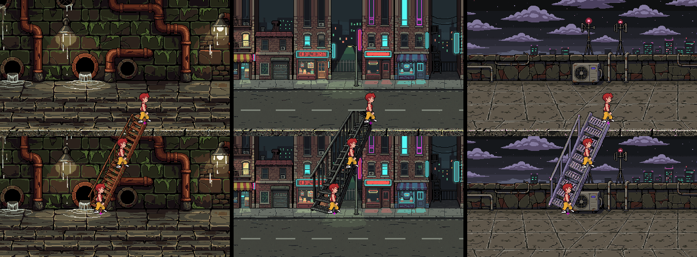
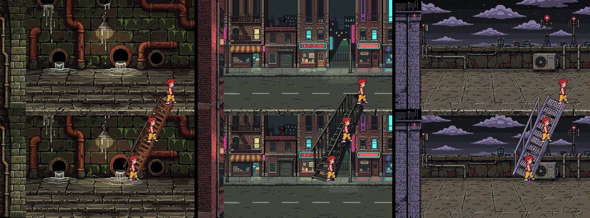

# Geração 2D dos mapas

> **Status:** implementado e testado fora do GameMaker. **Ainda não rodou no jogo:** sem licença, o GML não compila nesta máquina. O roteiro de teste com F5 está na seção 7.

## 1. Resumo

**Antes:** cada bioma era um corredor horizontal de 10 trechos emendados. O jogador percorria um único eixo x.

**Agora:**

- Cada bioma é um **nível 2D** montado numa grade de células.
- Cada célula mede 768 × 270 px: um tile do cenário de largura e uma tela de altura.
- Os corredores horizontais ficam em linhas diferentes da grade, ligados por **escadas percorríveis**. O personagem sobe andando e a câmera acompanha na vertical, sem troca de room.
- O **grafo** (`links`) guarda as conexões. A **grade** (`grid`) guarda as posições. `level_validate` confere que os dois concordam antes de aceitar o nível.

Exemplo real gerado pelo teste:

```
        0     1     2     3     4     5     6     7     8     9    10    11
 -2         [BEC!][esc ]
                    ||
 -1   [BECz][esc ][esc ][HOR ]
              ||
  0   [INI ][esc ][cmb ][... ][esc ][cmb ][cmb ][esc ][cmb ][...$][SAI ][CHF ]
                                ||                ||
  1               [BECT][cmb ][esc ]      [HOR ][esc ]
```

Legenda:

- **Tipos de célula:** INI início, CHF chefe, SAI saída (combate antes do chefe), cmb combate, esc escada, HOR horda, BEC beco, ... corredor livre.
- **Portas:** `$` loja, `T` tesouro, `!` desafio, `z` descanso.
- **Ligações:** `||` é uma escada entre a linha de cima e a de baixo. Células vizinhas na mesma linha sempre formam um corredor contínuo.




*Prévias montadas por `tools/mock_level.py` com a mesma geometria do jogo: personagem no pé, no meio e no topo da escada (marcas magenta = pontas do caminho).*

---

## 2. Como o nível é gerado

### 2.1 Coordenadas

- **Coluna `c`:** ocupa de `x1 = c × 768` a `x2 = x1 + 768`. O tile do cenário é a própria coluna, então as variantes com porta continuam encaixando.
- **Linha `r`:** a linha 0 é o corredor principal; as negativas ficam acima e as positivas abaixo, no máximo ±2.
- **Faixa:** no mundo, só as linhas usadas viram faixas, e a mais alta é a faixa 0. Cada faixa ocupa `oy = faixa × 270`, com chão de `oy + 178` a `oy + 258`.

### 2.2 Dados

O nível gerado (`scr_level_gen`, só dados) tem `grid`, `chunks`, `links` e `corridors`. `run_level_fill` (`scr_route`) o transforma no mapa jogável, guardado em `global.run.maps[i]`:

```
map = {
  version: 2, sid, biome, name, cell_w, band_h, cols, bands, width, height,
  grid[faixa][coluna]   -> índice do chunk ou -1                     (ESPAÇO)
  chunks[]              -> tipo, posição (x1, x2, oy, chão), estado do combate,
                           ondas, gatilho, porta (door, door_x), descoberta
  links[]               -> { a, b, kind: walk | stairs | door }       (GRAFO)
                           escadas: x_foot/y_foot (pé), x_top/y_top (topo), rise
  stairs[]              -> índices dos links de escada
  corridors[]           -> trechos contínuos: x1, x2, oy, chão, cap_left/cap_right
  start, boss, pickups, props, ground_weapons, pickups_taken, completed
}
```

### 2.3 Tipos de chunk

O registro fica em `chunk_types_init` (`scr_level_gen`). Um tipo novo é uma linha de registro e o conteúdo dele em `run_level_fill`.

| Tipo | Categoria | Aberturas | Onde fica | Conteúdo |
| --- | --- | --- | --- | --- |
| `start` | horizontal | direita | principal, coluna 0 | nascimento |
| `corridor` | horizontal | esquerda, direita, porta | qualquer corredor | objetos em 50% deles |
| `junction` | vertical | esquerda, direita, cima/baixo | qualquer corredor | uma escada |
| `combat` | combate | esquerda, direita, porta | principal e ramos | ondas de um módulo `mid` |
| `exit_combat` | combate | esquerda, direita, porta | antes do chefe | ondas do módulo `exit` |
| `horde` | combate | uma passagem só | ponta de ramo | +3 inimigos na última onda e um baú ao vencer |
| `dead_end` | exploração | uma passagem só, porta | ponta de ramo | uma arma e quebráveis, ou uma porta |
| `boss` | especial | esquerda (e a saída do bioma) | fim do principal | chefe do bioma |
| `interior` | interior | porta | fora da grade | sala que já existia: loja, tesouro, descanso ou desafio |

Portas não são um tipo de célula. São uma ligação `door` entre um chunk que aceita porta e um nó `interior` fora da grade. Assim, uma porta pode ficar num corredor livre, num combate (trancada durante a horda) ou no fundo de um beco.

### 2.4 Regras de conexão

1. Células vizinhas na mesma linha sempre se ligam por `walk`. Corredores diferentes na mesma linha ficam separados por pelo menos uma célula vazia.
2. `stairs` liga a mesma coluna em linhas vizinhas, e as duas pontas são `junction`. Cada célula tem no máximo uma escada, e no principal duas escadas nunca ficam encostadas.
3. Toda abertura usada precisa ser permitida pelo tipo (`sockets`). Becos e hordas têm exatamente uma passagem.
4. Escadas e portas ficam trancadas enquanto uma horda está ativa.

### 2.5 Passos da geração (`level_generate`)

1. **Principal:** linha 0, de 10 a 12 células. Coluna 0 é o início, a penúltima é a saída e a última é o chefe.
2. **Ramos:** de 2 a 3, alternando cima e baixo. Cada um tem de 2 a 4 células, posicionadas cobrindo a coluna da escada e com uma célula de folga em cada ponta.
3. **Sub-ramo:** com chance de 35%, o ramo cresce mais uma linha na mesma direção.
4. **Atalho:** com chance de 35%, uma segunda escada liga um ramo ao principal e fecha um ciclo (no máximo um por nível).
5. **Conteúdo:**
   - O principal recebe 5 combates, contando a saída, espalhados.
   - As pontas dos ramos viram becos e hordas (pelo menos um de cada quando há duas pontas).
   - As outras células dos ramos viram combate com chance de 30%.
6. **Salas interiores:**
   - A loja vai no principal.
   - Tesouro e desafio vão de preferência nos ramos, e de preferência no fundo de um beco.
   - O descanso aparece em 50% dos níveis.

### 2.6 Validação (`level_validate`)

Cada nível passa por estas checagens antes de ser aceito:

- Grade e chunks concordam: nada sobreposto e nada fora das linhas permitidas.
- Cada link tem a geometria certa, é simétrico e usa aberturas permitidas.
- As regras por chunk da seção 2.4 valem: escada única em cada `junction`, uma porta por chunk, becos e hordas na ponta.
- O principal está completo, com início, saída e chefe no lugar.
- Uma busca em largura (BFS) a partir do início alcança todos os chunks e o chefe.
- Os limites são respeitados:
  - até 24 células;
  - no máximo um ciclo;
  - comprimento dos ramos e número de ramos;
  - 5 combates no principal;
  - salas obrigatórias presentes, uma de cada, com a loja no principal.

Se a validação falhar, o gerador tenta de novo, até 12 vezes. Depois disso usa o **nível linear**, que sempre é válido. Nos testes houve em média 0,18 tentativa descartada por nível (sempre por excesso de células), e nenhum nível caiu no linear.

### 2.7 Em jogo

- **Corredor atual:** `global.stage_rt.corridor` guarda o corredor do jogador e define os limites de x (`stage_x1/x2`), o chão (`stage_floor_top/bottom`) e a câmera.
- **Paredes de fim de corredor:** os atores param a 50 px da parede. A ponta direita do corredor do chefe é a saída e não tem parede. Uma ponta com porta pintada rente à borda (o descanso do esgoto, a 32 px) fica sem parede, para a porta continuar alcançável.
- **Hordas:** disparam quando o jogador está dentro do chunk, a 120 px das bordas, vindo de qualquer lado. Os inimigos entram por fora da câmera, mas nunca de dentro de uma parede.
- **Escadas:**
  - No pé, encostado na parede, segure ↑ por 8 quadros (ou aperte E). No topo, na beirada da frente, segure ↓.
  - O estado `PS.CLIMB` segue o segmento pé→topo com a animação de andar, e o personagem fica invulnerável nesse trecho.
  - A câmera interpola o y entre as faixas. Ao chegar à ponta, o corredor atual troca.
- **Interiores:** continuam as salas de uma tela que já existiam. A volta usa o mesmo `return_context` (x e y).
- **Save:** o mapa vai inteiro no JSON (`version: 2`). Uma run salva no formato antigo é descartada ao continuar, com aviso, e o progresso permanente (meta) fica.

### 2.8 Minimapa

O minimapa lê só `map.grid`, `map.chunks` e `map.links`.

- **Compacto (canto):** uma janela de cerca de 7 células por 3 faixas em volta do jogador.
- **Expandido (TAB):**
  - a grade inteira do bioma;
  - a ordem dos biomas da run (os próximos aparecem como `???`);
  - a legenda;
  - os nomes das portas e o chefe.
- **Desenho:** barras coloridas pelo tipo e pelo estado do combate, escadas como traços verticais, portas como ícones e o jogador como ponto com seta (ele se move entre as faixas durante a subida).
- **Névoa:**
  - **Visitado:** cor e conteúdo à mostra.
  - **Conhecido:** contorno com `?`. O principal começa conhecido; vizinhos de uma célula visitada, a outra ponta das escadas e as salas das portas também ficam conhecidos.
  - **Desconhecido:** não aparece.

### 2.9 Configuração

O bloco `CFG.level` em `scr_config` reúne:

- **Tamanho da grade:** largura da célula (768) e altura da faixa (270).
- **Principal:** número de células (10 a 12) e de combates (5, contando a saída).
- **Ramos:** quantidade, comprimento e chances de sub-ramo, atalho e combate.
- **Becos e salas:** chance de horda nas pontas, salas interiores no principal e nos ramos, chance de descanso.
- **Limites:** máximo de células (24) e de tentativas (12).
- **Em jogo:**
  - recuo do gatilho de combate (120);
  - parada na parede (50) e distância das paredes para os inimigos nascerem (66);
  - escadas: zona de uso, tempo segurando a direção, velocidade da subida e deslocamento padrão;
  - inimigos extras da horda (3).

O teste em Node lê esse bloco, então ele só pode ter números, textos e listas. Há ainda `camera.lerp_y` (0.25) e `debug.level_overlay_key` (F2).

---

## 3. Arte nova

Toda a arte foi gerada no PixelLab com `create_image_pixen` e importada por `python tools/import_v3_level_art.py`. O importador troca cada cor pela mais próxima da paleta do cenário do mesmo bioma, então nenhuma cor nova entra no jogo. As imagens originais ficam em `tools/pixellab_raw/v3/`.

| Sprite | Tamanho | Origem | Uso |
| --- | --- | --- | --- |
| `spr_lvl_stairs_sewer` | 128×216 | pé (29, 211) | escada de manutenção de ferro enferrujado |
| `spr_lvl_stairs_streets` | 128×216 | pé (50, 215) | escada de incêndio de ferro preto |
| `spr_lvl_stairs_rooftops` | 128×216 | pé (40, 215) | escada de serviço de aço galvanizado |
| `spr_lvl_cap_sewer` / `_streets` / `_rooftops` | 64×270 | canto superior esquerdo | parede de fim de corredor (espelhada à direita) |
| `spr_lvl_slab_sewer` / `_streets` / `_rooftops` | 768×16 | canto superior esquerdo | laje entre faixas, a partir de uma laje neutra (`slab.png`) |

**Geometria das escadas:**

- O importador mede a linha dos degraus em cada arte e imprime o deslocamento horizontal da subida de 190 px.
- Os números medidos vão em `stage_stairs_run` (`scr_backdrop`): esgoto 92, ruas 76, telhados 84.
- A geração usa esse número para o caminho do jogador seguir os degraus.

**Escolhas:**

- Escadas de lance reto, para a animação de andar servir. A primeira escada das ruas veio em zigue-zague e foi refeita.
- A primeira parede dos telhados veio com escadas pintadas e foi refeita, para não parecer uma passagem falsa.
- A laje é uma imagem neutra recolorida por bioma, para caber no orçamento.

**Orçamento:** foram usadas 9 das 10 gerações diárias do plano trial: as 7 imagens aproveitadas (3 escadas, 3 paredes e a laje) e 2 refeitas.

**Desenho provisório:** sem a arte de um bioma, `level_art` devolve -1 e o jogo desenha formas simples na paleta do bioma.

---

## 4. O que não foi feito (e por quê)

- **Higgsfield:**
  - O servidor está configurado, mas precisa de login (`/mcp` → higgsfield → Authenticate) e de uma sessão nova. Nesta sessão as ferramentas dele não apareceram.
  - Os conceitos visuais propostos ficaram para depois: composição em corte de cada bioma e referências de interiores.
- **Cenários de outra altura:** faixas acima e abaixo do principal usam o mesmo cenário do bioma. O gancho já existe (`level_band_sprite`).
  - Cada variante precisa de uma imagem de 768×272 (1 geração).
  - Precisa também das quatro variantes com porta, montadas com o compositor de `tools/import_v2_art.py`.
- **Escada de marinheiro e elevador:** previstos como outros valores de `link.kind`. A escada de marinheiro precisa de animação de subida; o elevador, de uma plataforma.
- **Chunks de mais de uma célula:** a estrutura permite, mas todos os tipos ocupam uma célula. A arena do chefe passou de 640 para 768 px.

## 5. Sistemas alterados

| Arquivo | Mudança |
| --- | --- |
| `scripts/scr_level_gen` (novo) | Registro de tipos, grade, grafo, geração e validação (só dados). |
| `scripts/scr_level` (novo) | Corredor e faixa do jogador, chão da faixa, escadas próximas, descoberta, overlay F2. |
| `scripts/scr_route` | `run_maps_build` gera os níveis. `run_level_fill` monta ondas, hordas, becos, portas, escadas, armas e objetos. Saíram o posicionamento de entradas no corredor e a descoberta por x. Entrou `run_save_compatible`. |
| `scripts/scr_stage` | Altura do room por faixas; nascimento no corredor certo; portas e baús por chunk. Encontros e limites (`stage_x1/x2`) por chunk e por corredor. |
| `scripts/scr_player` | `PS.CLIMB`, entrada e saída das escadas, aviso "[W] SUBIR" / "[S] DESCER". |
| `scripts/scr_camera` | Eixo y, interpolação na escada, limites pelo corredor. |
| `scripts/scr_backdrop` | Cenário por corredor e por faixa (só o visível), paredes, laje, escadas, setas das escadas no HUD, `level_art`, `stage_stairs_run`. |
| `scripts/scr_minimap` | Reescrito em 2D. |
| `scr_actor`, `scr_enemy`, `scr_boss`, `scr_props`, `scr_fx`, `obj_door` | Chão da faixa no lugar do chão fixo; `cam.y` nas conversões para a tela; porta próxima pela faixa; carro das ruas só na faixa da câmera. |
| `scr_meta`, `scr_game`, `obj_game` | Descarte de runs antigas, registro dos tipos de chunk, F2. |
| `scr_config` | `CFG.level`, `camera.lerp_y`, `debug`. |
| `tools/` | `level_sim/level_sim.js` (testes), `import_v3_level_art.py` (arte), `mock_level.py` (prévia), `check_project.py` (prefixos novos). |

## 6. Testes já feitos

- **`node tools/level_sim/level_sim.js 2000`:**
  - Roda o arquivo GML real do gerador em 2000 seeds e o preenchimento real (`scr_route`, `scr_rooms`, `scr_props`, `scr_level`) em 900 mapas.
  - Confere de novo com código independente: sobreposição, ligações, alcance, chefe, salas, coordenadas, escadas (pé e topo encontrados, dentro do chão, fora das paredes), portas e armas alcançáveis, objetos no chão e mapa serializável em JSON.
  - Resultado: 0 falhas. Média de 20 células, 3,7 faixas, 3,2 escadas e 3,5 portas por mapa; 59% dos níveis têm linha ±2 e 13% têm atalho.
- **`--linear`:** o nível de reserva passou em 500 seeds.
- **`python tools/check_project.py`:** 0 problemas.
- **Igor:** carrega e liga o projeto inteiro com os recursos novos (`SUCCESSFUL LOAD AND LINK`). A compilação para na falta de licença.

## 7. Roteiro de teste no GameMaker (F5)

1. Comece uma run e aperte F2 para ver chunks, ligações e zonas das escadas.
2. **Escadas:** suba e desça cada uma. Confira:
   - a câmera acompanhando;
   - o personagem saindo no chão certo;
   - o aviso SUBIR/DESCER;
   - a escada trancada durante uma horda.
3. **Hordas em becos:** nenhum inimigo deve nascer dentro da parede, e o baú aparece ao vencer.
4. **Portas:** entre em cada sala interior e volte; deve voltar ao mesmo ponto, inclusive em faixas de cima e de baixo.
5. **Minimapa:** compacto e TAB; névoa; ponto do jogador durante a subida.
6. **Chefe:** vença e saia pela direita para o próximo bioma.
7. **Save:** salve num combate limpo e continue.
8. Repita com seeds diferentes (a seed aparece acima do minimapa).

## 8. Limitações conhecidas

- O GML não foi compilado. Podem aparecer erros de sintaxe ou de execução no F5.
- Durante a subida, a lateral de um corredor mais curto mostra o vazio entre corredores (massa escura).
- Mais objetos por mapa que antes: cerca de 28, contra uma estimativa de 22 no corredor antigo, porque corredores livres e becos também recebem quebráveis. Ajuste em `CFG.level.corridor_props_chance` e `CFG.props.breakables_per_section`.
- O caminho obrigatório tem 5 combates (antes eram 8); os ramos somam de 1 a 4 opcionais. Ajuste em `CFG.level.main_combats`.
- O teste em Node usa outro gerador aleatório: a mesma seed gera mapas diferentes no jogo e no teste.
